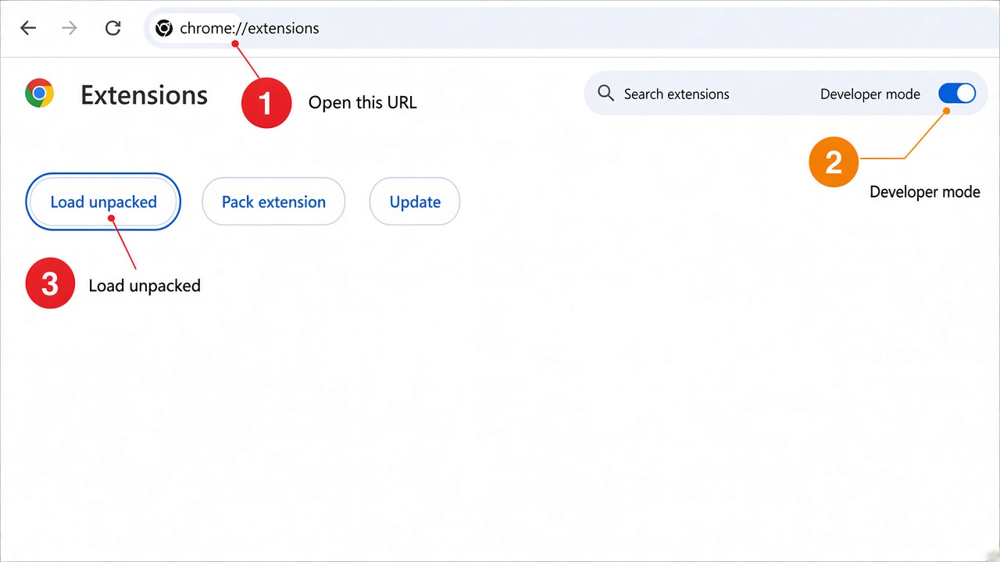

# Load Detour unpacked (Developer mode)

This zip is the **extension only** (store / sideload). It does **not** include the Databases helper. For a one-download setup with the helper, use an OS pack from [GitHub Releases](https://github.com/proto-void/detour/releases) (`detour-<version>-<os>-<arch>.zip`).

**First:** Unzip this archive to a folder you will keep. Do **not** Load unpacked the `.zip` itself — Chrome needs the folder that contains `manifest.json`.

## Chrome



1. Open `chrome://extensions`
2. Turn on **Developer mode** (top right)
3. Click **Load unpacked**
4. Select the **unzipped folder** that contains `manifest.json` (this folder if you unzipped a flat zip, or the `extension/` folder inside an OS pack)

Chrome may show a “Disable developer mode extensions” banner on startup — click **Keep**.

## Edge / Brave

Same steps at `edge://extensions` or `brave://extensions`.

## Firefox

Prefer the [AMO](https://addons.mozilla.org/) listing. For a temporary test: `about:debugging` → **This Firefox** → **Load Temporary Add-on** → select `manifest.json`.

## Databases helper

If you need **Databases**, install a helper from an OS pack (double-click **Install Detour Helper**) or, as a developer with Node 24+:

```sh
corepack pnpm --filter @detour/cli exec detour db install
```

See the root README **Connect to a database** section.
